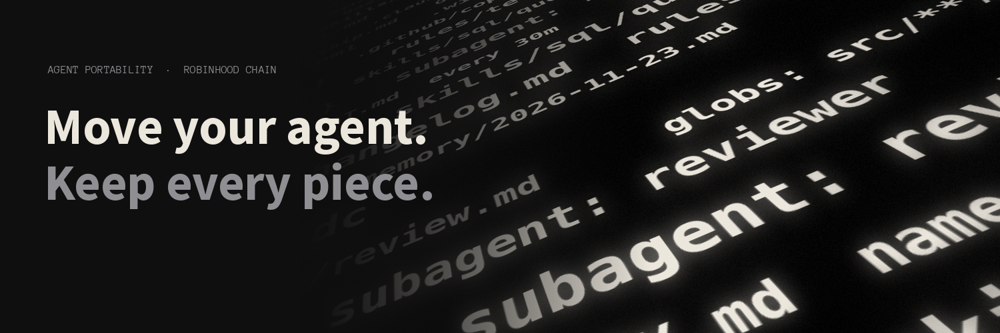
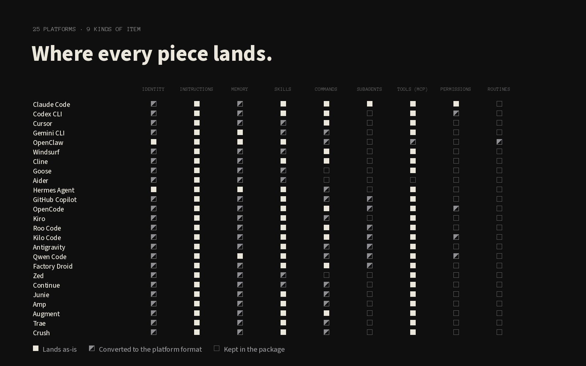

<p align="center">
  
</p>

<h1 align="center">Barge</h1>

<p align="center">
  Move your AI agent to any platform. Keep every piece.<br>
  <a href="https://bargedot.fun">bargedot.fun</a> · <a href="https://bargedot.fun/app">App</a> · <a href="https://bargedot.fun/harbor">Harbor</a> · <a href="https://x.com/usebarge">X</a>
</p>

<p align="center">
  <a href="https://bargedot.fun/app"></a>
</p>

---

Every AI agent ends up tied to the tool it was built in: a `CLAUDE.md` here, `.cursor/rules` there, commands in a folder only one app understands. Barge reads an agent from the platform it was built on and lands it on the one you use next, without losing a single piece.

It runs entirely in your browser. Your files are never uploaded and your original folder is never edited.

## What travels

Barge reads nine kinds of item and converts each one to the format the new platform expects:

| Item | What it covers |
| --- | --- |
| Identity | Name, persona and a stable agent ID |
| Instructions | Main prompt, rules and scoped rules with their globs |
| Memory | Saved facts, profiles and daily notes |
| Skills | Skill folders with their scripts and references |
| Commands | Slash commands, prompts and workflows |
| Subagents | Helpers with their own role and tools |
| MCP servers | Local and remote servers, keys turned into variables |
| Permissions | Allow, ask and deny rules where the platform supports them |
| Routines | Heartbeats and scheduled checks, paused until you switch them on |

When the new platform has no equivalent for an item, it rides along inside a `.barge` package, a plain and versioned file that remembers where every item came from.

## 25 platforms

Claude Code, Codex CLI, Cursor, Gemini CLI, OpenClaw, Windsurf, Cline, Goose, Aider, Hermes Agent, GitHub Copilot, OpenCode, Kiro, Roo Code, Kilo Code, Antigravity, Qwen Code, Factory Droid, Zed, Continue, Junie, Amp, Augment, Trae and Crush.

<p align="center">
  
</p>

## Use it

**In the browser:** open [bargedot.fun/app](https://bargedot.fun/app), drop the folder your agent lives in (or a zip, a public GitHub repo, or a `.barge` package), pick the new platform and download the result.

**From the terminal**, in the folder your agent lives in:

```bash
npx -y https://bargedot.fun/bargedot.tgz cursor      # this agent, laid out for Cursor
npx -y https://bargedot.fun/bargedot.tgz everywhere  # one zip with all 25 platforms
npx -y https://bargedot.fun/bargedot.tgz list        # platform ids
```

Options: `--out <file.zip>`, `--name <agent name>`, `--force`.

**Badge** for your agent's README:

```markdown
[](https://bargedot.fun/app?repo=OWNER/REPO)
```

## Harbor and lineage

The **Harbor** is a public library of agents. Publishing is signed with your wallet (a message, no transaction, no fee). Secrets are stripped in the browser and again on the server.

Each move can be recorded on **Robinhood Chain** (chain id 4663):

| Contract | Address |
| --- | --- |
| BargeLineage | [`0x34b304202f43f86d01c0716cC5244eDd390166A9`](https://robinhoodchain.blockscout.com/address/0x34b304202f43f86d01c0716cC5244eDd390166A9) |
| BargePassport | [`0x3Fc6c58c800E643404084E97B49E9E9554Bbdb55`](https://robinhoodchain.blockscout.com/address/0x3Fc6c58c800E643404084E97B49E9E9554Bbdb55) |

Both contracts have no owner, no fees and no upgrades. Lineages are keyed by holder and agent, so nobody can write into someone else's lineage.

## Repository

```
cli/         the bargedot command line tool
contracts/   BargeLineage and BargePassport (Foundry)
web/site/    the static app served at bargedot.fun
web/src/     the Cloudflare Worker behind the Harbor API
tools/       engine and worker test suites
```

Run the tests:

```bash
node tools/test-engine.cjs
node tools/test-worker.mjs
cd contracts && forge install foundry-rs/forge-std && forge test
```

## $BARGE

Barge is free for everyone. $BARGE is its token on Robinhood Chain. Holders of 0.1% of the supply get a Holder badge on the agents they publish, and their agents lead the Harbor.

## License

MIT
